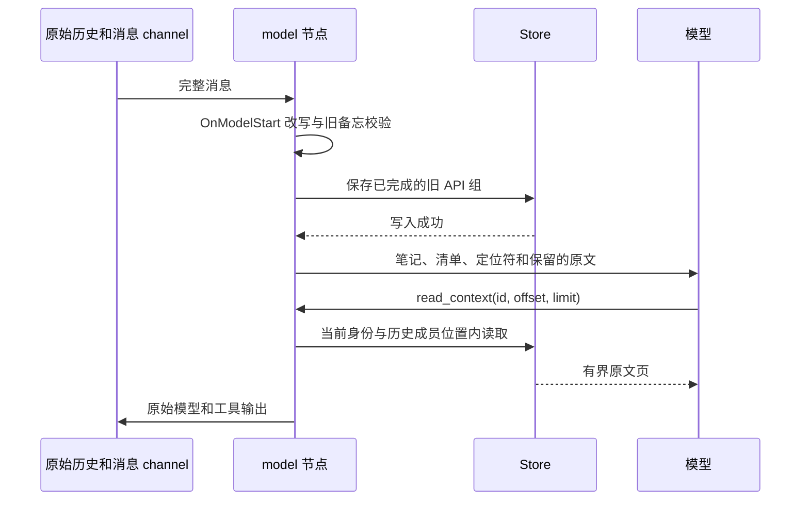

# 可取回的上下文折叠

`agent_v2.WithContextRecovery` 在对话超过预算时，把已完成的旧 API 消息组换成笔记、调用清单和原文定位符。`read_context` 按需取回原文。这是借鉴 Folio 的分层恢复实现，默认关闭，不增加摘要模型调用。

## 使用

```go
archive := store.NewInMemoryStore()
agent := agent_v2.NewBasicAgent(
    agent_v2.WithName("researcher"),
    agent_v2.WithModel(llm),
    agent_v2.WithContextRecovery(&agent_v2.ContextRecoveryConfig{
        Store: archive,
        MaxTokens: 16000,
        KeepRecentRounds: 4,
        NoteBytes: 256,
    }),
)
```

`llm` 是业务提供的 `model.ChatModel`。省略 `Store` 时使用本次 ctx 的 Store；`WithContextRecovery(nil)` 使用默认配置。配置会复制，Store 的生命周期由应用管理。生产环境需用可持久化的 Store，并在跨 Run、重建 agent 和 Resume 时沿用相同存储。

| 字段 | 默认与行为 |
| --- | --- |
| `MaxTokens` | `<=0` 用 16000；按 `compose_v2.EstimateMessageTokens` 估算对话，超过时从旧组开始折叠。前言和工具定义不在这个预算内。 |
| `KeepRecentRounds` | `<=0` 用 4；至少保留最近这么多个 API 消息组。 |
| `NoteBytes` | `<=0` 用 256，最大 2000；笔记字节上限，截断保持 UTF-8。 |
| `TTL` | `<=0` 不过期；仅在实现 `store.TTLAware` 且支持 TTL 的后端上传递。 |

预算是折叠目标。当前用户输入、近期组、未完成调用、system、Skill 正文、已有恢复视图等受保护内容可以使最终输入仍超出预算，之后继续走已有 MicroCompact、AutoCompact 和 ReactiveCompact。

归档前，在完整送模视图中按声明顺序逐块配对工具结果。带历史任务标记的消息也核对任务和成员归属。一个合并消息可以应答多个调用，每个结果块各应答一次。有未配对的声明或结果时保留所在组。配对跨越组边界时保留涉及的组。

## 笔记、清单与原文

1. 笔记优先取消息的 `ContextRecoveryNoteAnnotation` 字符串；没有时从正文取有界预览。业务可在生成消息或钩子中提供笔记。
2. 调用清单由运行时生成，列角色、工具名、调用 ID 和结果 ID，不依赖模型复述。
3. 原文以带版本号的 JSON 存在 Store 中，包含角色、正文、推理文本、拒答和内容块。应用 annotations、计费 metadata 与独立 Preamble 不归档。

这是一条可取回的旧上下文视图。它不会自动要求模型在普通回复中生成 Folio 的 L1 笔记，也没有实现论文中的 dossier 管理或价格优化器；未做论文任务集上的效果对比。

原文归档发生在 `OnModelStart` 改写之后、MicroCompact 之前。模型通过恢复工具看到的仍是钩子允许进入模型视图的字段。脱敏钩子应处理消息实际携带的正文与内容块，不能只改一个重复表示。

## 状态归属与恢复

不变量：**原始历史和工具账本不因折叠改写，只有成功写入 Store 的完整旧组才能产生定位符。**



| 状态 | producer 与 consumer | 寿命 |
| --- | --- | --- |
| 原始消息 | 模型与工具产生，channel、工具账与 HistoryStore 使用 | 按原有 Run、checkpoint 与会话历史契约 |
| 折叠备忘 | model 节点产生，后续模型轮次使用 | 随 checkpoint 序列化；原前缀或相关标注变化后重新计算 |
| 跨 Run 视图 | 从完整历史重新按预算折叠 | 不发布折叠历史快照，避免覆盖并发任务追加；同内容沿用原定位符 |
| 归档原文 | 折叠器写入，`read_context` 读取 | Store 决定；不会在单次 Run 成功清档时删除 |

归档 namespace 为 `_context_recovery` 加 owner、thread（没有 thread 时用任务）及稳定历史成员位置的哈希。顶层位置回落到 agent 名。Loop 的执行 namespace 随轮次变化，归档沿用稳定的历史位置；跨 Run 重建时应保持名字或成员注册位置稳定。同名 agent 位于不同成员位置时互相隔离。

定位符由归档内容生成，重复写同一内容使用同一键。同 Run 的备忘复用已折叠的前缀，跨 Run 会重读历史并重新折叠（可能重复写相同键）；恢复工具的页只追加成新的工具结果，不把旧笔记自动展开成更长前缀。

写失败或没有 Store 时保留原组。取消仍沿调用链返回；部分已写入的内容在重试时复用同一键。原文过期或被应用清理后，读取返回 `not_found`，既有笔记仍保留。需要持续恢复的应用应让归档寿命覆盖挂起任务与历史的使用时间。

## `read_context` 参数与结果

```json
{"id":"cx_...","offset":0,"limit":2000,"query":"需要查找的原文片段"}
```

- `id` 取笔记中的定位符，不接受自选 namespace。
- `offset` 从 0 开始，是归档 JSON 的 UTF-8 字节位置；后续使用上次的 `next_offset`。
- `limit` 默认 2000，最多 2000 字节。不得为负或零；不足以容纳一个完整字符时返回参数错误。
- `query` 可选，从 offset 开始查找字面文本，最多 256 字节。没有匹配时返回 `not_found`。

成功结果包含 `id`、`offset`、`next_offset`、`total_bytes`、`eof` 和 `text`。分页以 UTF-8 边界结束，JSON 转义后的整个结果仍有固定上界。读取错误作为工具失败结果交给模型。

## 回归入口

```bash
go test ./agent_v2 -run '^TestContextRecovery' -count=1
```

覆盖生产 BasicAgent 的大工具结果、HITL 与 Resume、工具配对和原历史保留；真实 Loop 覆盖跨轮稳定寻址。内部回归验证写入失败、受保护消息、待答调用、分页、检索以及 owner、会话和成员位置隔离。

ContextRecovery 的折叠备忘随本次 Run 保存。单独启用时，下一次 Run 从历史重建视图。两者同时启用时，只有实际完成的 AutoCompact 摘要可以发布跨 Run 边界，且须由后端确认读取与写入覆盖同一连续前缀。[并发历史边界](../issue/issue-100-history-compaction-concurrent.md)

相关设计见[上下文压缩](context-compaction.md)、[Store](store.md)及[三方决策记录](../description/three-way-comparison/context-compaction.md#2026-11-23可取回的折叠视图)。
